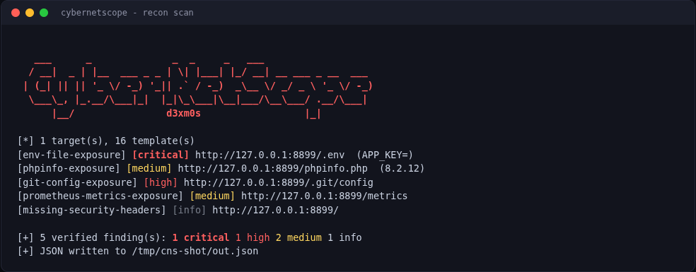

# CyberNetScope

Template-driven vulnerability scanner in a single, dependency-free C++17
binary. Point it at a URL and it runs a battery of community-writable YAML
checks, verifies every hit against the live response, and drops anything that
smells like a false positive.



[Русская версия ниже](#cybernetscope-русская-версия)

## What it does

- **Verified findings only.** Every template is a set of matchers that must
  all hold on the real response. No match, no report.
- **Soft-404 calibration.** Before scanning a target, cybernetscope fetches a
  random path and records the baseline. Templates that also match the baseline
  are matching the server's catch-all page, not a vulnerability - they get
  suppressed automatically.
- **Zero runtime deps.** One binary, OpenSSL is the only link.
- **SARIF out of the box** for CI/code-scanning pipelines, plus JSON and
  grepable output.

## Build

One shot - installs dependencies, compiles, done:

```bash
./install.sh
```

Add `--install` to also install system-wide. The script covers apt, dnf,
yum, pacman, zypper and brew. Prefer to do it by hand:

```bash
sudo apt install build-essential cmake libssl-dev   # Debian/Ubuntu/Kali
cmake -B build
cmake --build build
```

## Usage

```bash
./build/cybernetscope -u https://example.com
./build/cybernetscope -u https://example.com -u http://10.0.0.5:8080
./build/cybernetscope -iL targets.txt --severity high,critical
./build/cybernetscope -u https://example.com --tags exposure -j out.json --sarif out.sarif
```

### Options

| Option | Description |
|--------|-------------|
| `-u, --url URL` | Target URL or host (repeatable). Bare hosts probe https first |
| `-iL, --input FILE` | Read targets from FILE, one per line |
| `-t, --templates DIR` | Template directory (default: `./templates`) |
| `--tags A,B` | Only run templates with these tags |
| `--exclude-tags A,B` | Skip templates with these tags |
| `--severity S,S` | Only these severities (info,low,medium,high,critical) |
| `--threads N` | Concurrent workers (default: 50) |
| `--timeout MS` | Per-request timeout (default: 8000) |
| `--rate RPS` | Global request rate limit, 0 = unlimited |
| `--no-calibrate` | Skip the soft-404 baseline check |
| `-j, --json FILE` | Write findings as JSON |
| `--sarif FILE` | Write findings as SARIF 2.1.0 |
| `-oG, --grepable FILE` | Grepable lines (`-` for stdout) |
| `-q, --quiet` | Findings only |
| `--no-color` | Disable colored output |

## Writing templates

Templates are plain YAML. A minimal one:

```yaml
id: my-check
info:
  name: Example panel exposed
  severity: medium
  tags: [panel, exposure]
requests:
  - method: GET
    path: ["/admin", "/admin/"]
    redirects: false
    matchers:
      - type: status
        status: [200]
      - type: word
        words: ["<title>Example Admin</title>"]
        condition: and
    extractors:
      - type: regex
        regex: ["version ([0-9.]+)"]
        group: 1
```

Matchers: `status`, `word`, `regex`, `binary` (hex strings). Each matcher
takes `part` (`body`, `header`, `raw`), `condition` (`and`/`or` across its
entries) and `negative: true`. Matchers inside one request combine with
`matchers-condition` (default `and`). Regexes are ECMAScript; prefix with
`(?i)` for case-insensitive.

Drop the file under `templates/` and it runs on the next scan.

## Project layout

```
cybernetscope/
├── include/cybernetscope/    public headers
├── src/              engine, http client, template loader, yaml, reporters
└── templates/        bundled checks (exposures, misconfig, tech detection)
```

## Legal

Scan only systems you own or have explicit written permission to test.
Unauthorized scanning may be illegal. You are responsible for how you use
this tool.

## License

MIT. Copyright (c) 2026 d3xm0s.

---

# cybernetscope (русская версия)

Сканер уязвимостей на YAML-шаблонах в одном C++17 бинаре без зависимостей.
Запускаешь против URL - он гоняет батарею проверок, подтверждает каждую
находку живым ответом и отбрасывает всё, что похоже на ложное срабатывание.

## Что умеет

- **Только подтверждённые находки.** Шаблон - это набор матчеров, которые
  обязаны сработать на реальном ответе. Не совпало - нет находки.
- **Калибровка soft-404.** Перед сканом запрашивается случайный путь и
  запоминается ответ-эталон. Шаблон, сработавший и на эталоне, поймал
  заглушку сервера, а не уязвимость - и подавляется автоматически.
- **Ноль зависимостей.** Один бинарь, линкуется только с OpenSSL.
- **SARIF из коробки** для CI и code scanning, плюс JSON и grepable.

## Сборка

Одна команда - ставит зависимости, собирает, готово:

```bash
./install.sh
```

С `--install` дополнительно установит в систему. Скрипт покрывает apt, dnf,
yum, pacman, zypper и brew. Вручную (Debian/Ubuntu/Kali):

```bash
sudo apt install build-essential cmake libssl-dev
cmake -B build
cmake --build build
```

## Использование

```bash
./build/cybernetscope -u https://example.com
./build/cybernetscope -iL targets.txt --severity high,critical
./build/cybernetscope -u https://example.com --tags exposure -j out.json --sarif out.sarif
```

Опции и формат шаблонов - в английской секции выше, они полностью совпадают.

## Юридическое

Сканируйте только те системы, которыми владеете или на тест которых есть
явное письменное разрешение. Ответственность за использование - на вас.

## License

MIT. Copyright (c) 2026 d3xm0s.
